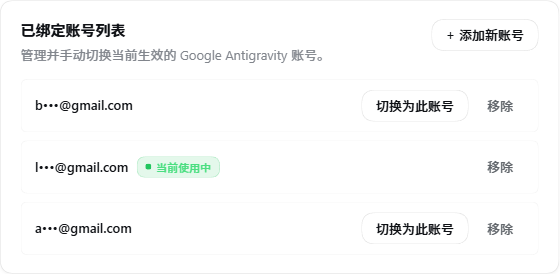
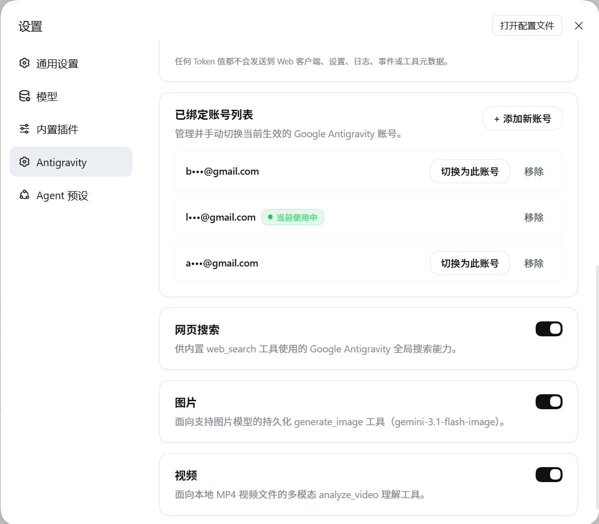

# dsh-antigravity-plus (Antigravity+)

[](https://www.npmjs.com/package/dsh-antigravity-plus)
[](LICENSE)
[](https://github.com/deepseek-ai/deepseek-harness)

**English** | [简体中文](README.zh.md)

> **✨ Enhanced Antigravity Suite for DeepSeek Harness**: An all-in-one capability bundle designed for official [DeepSeek Harness (DSH)](https://github.com/deepseek-ai/deepseek-harness) Web and Desktop clients. Featuring **Smart Proxy Auto-Sniffing**, **Multi-Account Quota Failover**, and an **Omni-Modal Tool Suite**.

## Current Usage and Release Status (2026-10-11)

- **Currently enabled in Desktop**: `dsh-antigravity-auth v0.1.4-rc.6` (a locally linked package). It uses the Host's `HTTPS_PROXY` / `ALL_PROXY` environment variables; it does not scan common local proxy ports such as `127.0.0.1:7890/7897/10809`. The active Desktop plugin has passed account reads, quota reads, and one minimal text model request.
- **This Plus repository**: The package is `dsh-antigravity-plus`; its current fixes are in [PR #2](https://github.com/worker100/dsh-antigravity-plus/pull/2). It prioritizes Host proxy environment variables, then probes common local HTTP proxy ports. `/anti proxy` reports the route actually selected.
- **Deployment status**: Plus is present in the Desktop profile's dependency list only. It is not in `dsh.profile.bundles`, so Desktop does not load it. PR #2's offline checks and proxy tunnel regression tests pass; the repaired Plus build has not yet passed Desktop OAuth, quota-read, and model-request acceptance. The PR remains Draft, and Plus is not the current stable Desktop version.
- **Project direction**: This GitHub repository currently contains the Plus implementation, not the older package running in Desktop. Adopting and renaming the older package as the long-term baseline would require a separate review of package name, DSH bundle identity, account-store migration, and rollback. A display-name change alone does not switch Desktop and should not be mixed into this proxy-fix release.

The feature list below describes **the Plus code in this repository**. The features currently available in Desktop come from the active `dsh-antigravity-auth` bundle.

---

## 🌟 Highlights & Capabilities

### 1. 🚀 Smart Proxy Engine
- **Local Proxy Port Sniffing**: When the Host has no `HTTPS_PROXY` / `ALL_PROXY`, probes `127.0.0.1` ports `7890`, `7897`, `10809`, `6152`, and `2080` in order. This only checks whether a port accepts a connection; it does not identify the user's region, VPN/TUN state, or whether the proxy node can reach Google.
- **Automatic Routing**: Honors `NO_PROXY`, then uses Host `HTTPS_PROXY` / `ALL_PROXY`, then probes the listed local HTTP proxy ports. If none match, it connects directly. `/anti proxy` reports the route selected by the plugin; the settings panel has no manual proxy URL input.
- **Direct Fallback**: Direct connection means no configured or detected proxy matched. It does not mean the plugin detected an overseas network or TUN mode.
- **Diagnostic Guidance**: Human-friendly error reporting that distinguishes temporary network dropouts from expired authentication credentials.

### 2. 🔄 Multi-Account Quota Failover & Auto-Healing
- **Bounded Failover**: Automatically rotates to the next available bound account upon receiving `429` (Quota Exhausted) before any stream output has been committed.
- **Instant Switching**: Change active accounts with a single click in the UI or via `/anti switch <id>`.
- **Host-Only Secure Storage**: Credentials remain strictly on the host file system with OS-level permissions (Windows ACL / POSIX 0600).
- **Seamless Migration**: Automatically detects and imports legacy `dsh-antigravity-auth` credentials on initial startup.

### 3. 🎨 Omni-Modal Model & Tool Suite
- **Comprehensive Model Support**: Native routing for Gemini 3.8 Flash (Low/Medium/High thinking budgets), Gemini 3.1 Pro, Claude 3.7 Sonnet, Claude Opus, and GPT-OSS.
- **Grounded Web Search (`web_search`)**: Dispatches grounded search queries with verified citations.
- **Image Generation & Gallery (`generate_image` / `list_images`)**: Persistent workspace image generation with multi-image reference inputs.
- **Video Understanding (`analyze_video`)**: Multimodal frame sampling and reasoning on local MP4 video files.

### 4. 📊 Elegant Usage Dashboard
- **Real-Time Usage Visualizer**: 5-hour and weekly quota bars with Emerald, Amber, and Crimson warning tones.
- **Humanized Countdown**: Times exceeding 24 hours are displayed naturally (e.g. `3d 22h 43m`).

---

## 📸 Screenshots

Captured on DSH `0.2.0-rc.2` Web and Official Desktop surfaces:

| Web Settings & Usage Dashboard | Desktop Usage Metrics |
|:---:|:---:|
|  |  |

---

## 🖥️ Official Surface Architecture: Web GUI vs Desktop

DeepSeek Harness provides two official graphical surfaces. This plugin can be installed in Web and Desktop profiles; whether a particular build has passed live acceptance is stated in the current status section above:

| Dimension | **Web GUI (Browser Surface)** | **Desktop (Official Electron App)** |
|---|---|---|
| **Official Term** | `dsh web` (Web Profile) | `desktop` Profile (Electron Client) |
| **Runtime Host** | Local Node.js server + browser (Chrome/Edge) | Standalone `DeepSeek Harness.exe` binary |
| **Port / Entrance** | Default `3080` (or custom port like `19387`) | Native window with system tray integration |
| **Profile Management** | Stored in `$DSH_HOME/profiles/web`, CLI dynamic | **Exclusively managed by Electron** |
| **Component Presentation** | Shared Cordis React cards & streaming gauges | Shared Cordis React cards & streaming gauges |

> ⚠️ **Note**: DSH CLI prevents manual modifications to the `desktop` profile from the terminal (reporting `profile "desktop" is managed exclusively by the Electron application`). To link this plugin to Desktop, register it directly in the desktop `package.json` file as shown below.

---

## ⚡ Quickstart

### 1. Prerequisites
- [DeepSeek Harness](https://github.com/deepseek-ai/deepseek-harness) (`0.2.0-rc.2` or later recommended);
- Node.js `>= 22.19.0` with `pnpm`;
- A Google account with Antigravity access.

### 2. Installation

#### Web Surface
```powershell
dsh --profile web-antigravity --from-default-profile web --no-open
dsh plugin --profile web-antigravity add link:D:/Projects/Active-Dev/dsh-antigravity-plus
dsh --profile web-antigravity
```

#### Official Desktop Surface
1. Exit the running DeepSeek Harness desktop application.
2. Open `%USERPROFILE%\.dsh\profiles\desktop\package.json`, and add the dependency:
   ```json
   "dependencies": {
     "dsh-antigravity-plus": "link:D:/Projects/Active-Dev/dsh-antigravity-plus"
   }
   ```
   Add `"dsh-antigravity-plus"` to `dsh.profile.bundles`.
3. Run `pnpm install` in that profile directory.
4. Launch the desktop application.

### 3. Authorization
- **Via Settings UI**: Open Settings -> Click `Antigravity` -> Click `Start Antigravity login` to open Google OAuth in your default browser.
- **Via Slash Command**:
  ```text
  /anti login
  ```

---

## ⌨️ Slash Commands (`/anti`)

| Command | Description |
|---|---|
| `/anti` / `/anti status` | Display current account status, active models, and capabilities |
| `/anti login` | Initiate Google OAuth PKCE authorization |
| `/anti list` | List all bound accounts and identify the active account |
| `/anti switch <account>` | Switch active account immediately |
| `/anti proxy` | Inspect proxy detection status and active port |
| `/anti logout` | Clear active memory credentials and log out locally |
| `/anti cancel` | Cancel pending authorization |

---

## 🔒 Security & Privacy

- **Host-Confined Secrets**: Tokens, authorization codes, and refresh secrets are stored strictly on the Host and never dispatched to client browsers, logs, or LLM context prompts.
- **PKCE S256**: Standards-compliant OAuth 2.0 PKCE flow with single-use loopback binding strictly on `127.0.0.1:51121`.
- **Disclaimer**: Unofficial community adapter for experimental personal development. Please review Google Antigravity Terms of Service.

---

## 🙏 Acknowledgments

This project builds upon the foundational research of the community:

- **[dsh-antigravity-auth](https://github.com/suntianc/dsh-antigravity-auth)**: Pioneer architecture for DSH Antigravity integration and contract definitions.
- **[@cortexkit/antigravity-auth](https://github.com/cortexkit/antigravity-auth)**: Invaluable reverse-engineering insights on private Cloud Code contracts.
- **[DeepSeek Harness](https://github.com/deepseek-ai/deepseek-harness)**: The extensible Agent Harness foundation.

---

## 📄 License

Released under the [MIT License](LICENSE).
